# 海报会说话——电影海报配色的类型结构、时间演变与地区差异实证研究

> **课程名称**：数据分析实践 · 课程大作业  
> **样本规模**：TMDB 1950—2025 年 19,700 部电影元数据与 19,694 张原语言海报  
> **分析维度**：结构（类型与色型聚类）· 时间（七十六年演变）· 效用（口碑关联）· 空间（七大国家／地区组）

---

## 摘要

电影海报是观众接触影片的第一视觉界面。围绕「海报配色究竟传递什么信息」这一核心问题，本文基于 TMDB 1950—2025 年按「每年投票人数前 2.6%」动态分位门槛采集的 19,700 部电影元数据及去本地化后的 19,694 张原语言版海报，在裁除底部 12% 演职员文字区并实施近灰像素掩膜（$S \ge 0.20$）与色相有效闸门（$\text{sat\_frac} \ge 0.10$，$N = 19,072$）的基础上，从**类型结构、时间演变、口碑效用、地区空间**四个维度展开统计估计与稳健性检验。主要结论如下：

1. **结构维度（类型分化与客观色型）**：不同电影类型的配色存在系统性差异，其中**明度是区分类型最强的单一指标**（互斥子集 $\eta^2_H = 0.2193$）。喜剧（均值 0.6305）、动画（0.6082）、爱情（0.6034）显著偏亮，科幻（0.4835）、惊悚（0.4401）、恐怖（0.4044）依次偏暗，爱情片较恐怖片平均明度高出 0.1990（电影级联合重采样 95% CI $[+0.1902, +0.2078]$）；色相上爱情片在 $0^\circ\text{–}60^\circ$ 红橙黄波段较科幻片高 14.83 个百分点，科幻片在 $180^\circ\text{–}240^\circ$ 青蓝波段较爱情片高 11.09 个百分点，且在单张海报内屏蔽 $0^\circ\text{–}60^\circ$ 人脸肤色高发区重归一后格局不变。进一步在不输入任何类型标签的圆锥色度空间执行无监督聚类（$k=4$，Davies–Bouldin = 1.1803，子样本一致性 ARI = 0.9913），识别出**明亮浅调（28.65%）、浓烈暖调（25.93%）、青蓝冷调（19.42%）、深暗低彩（25.99%）**四类跨题材共享色型模板：各类型并非独占单一专属颜色，而是对四类模板的配置比例呈现大幅偏移（如爱情与喜剧各有约 40% 落入明亮浅调，动画有 68.8% 集中于青蓝冷调与浓烈暖调，恐怖与惊悚各有逾 40% 落入深暗低彩）。
2. **时间维度（1950—2025 年演变）**：2010 年代相对 1950 年代，全球样本海报平均明度下降 0.0705（95% CI $[-0.0835, -0.0588]$），色彩丰富度下降 16.88（$[-19.33, -14.57]$），$0^\circ\text{–}60^\circ$ 暖色平均占比由 58.6% 降至 47.8%，$180^\circ\text{–}240^\circ$ 青蓝占比由 17.4% 升至 27.7%。但五年移动窗口揭示演变并非单调线性：2020—2025 年相对 2010 年代明度继续走低（$-0.0364$），平均饱和度却显著回升（$+0.0424$，$[+0.0347, +0.0507]$），不能简单概括为「持续变灰」。
3. **效用维度（口碑预测力检验）**：在 19,592 部有效评分影片中，海报平均明度（$r = +0.047$）、平均饱和度（$r = -0.052$）与色彩丰富度（$r = -0.045$）同 TMDB 均分的相关系数全部落在 $\pm 0.08$ 以内（$R^2 < 0.3\%$），分八大类型考察亦全部贴近零点。大样本下极小的 $p$ 值不代表实质关联，实证表明**海报配色是帮助观众快速识别题材的「类型信号」，而非反映影片好坏的「质量信号」**。
4. **空间维度（2001—2025 年地区对比）**：基于参与制片国与原语言规则推定的七组共 10,115 部影片中，相对美国组（明度 0.5193，饱和度 0.4156），法国组（$+0.0598$）、意大利组（$+0.0715$）与日本组（$+0.0470$）平均明度更高，且日本组 $0^\circ\text{–}60^\circ$ 暖色占比更低（37.5% vs 美国 48.4%）；华语组（$-0.0511$）与韩国组（$-0.0772$）平均更暗，韩国组平均饱和度低出 0.1032（$[-0.1240, -0.0825]$）。报告最后从海报发行年份不可观测、合拍归属推定、印制媒介演变与平台覆盖偏倚五个方面界定了结论的适用边界。

---

## 1. 研究问题与分析框架

在电影宣发工业中，海报往往在数秒之内建立观众对影片基调的第一印象。围绕电影海报色彩，常见直觉与经验说法交织：例如「科幻片偏蓝、恐怖片偏暗绿、爱情片偏粉暖」「现代电影海报越来越暗、越来越流行青橙撞色」「高水准电影在视觉配色上更克制高级」以及「东亚与欧美院线海报存在鲜明色调分野」。然而，这些判断在多大程度上能够经受大规模样本的定量检验？

本文将上述直觉拆解为四个正交且递进的实证问题：

1. **结构问题（类型 × 配色）**：预设电影类型后，不同类型的色相分布与明暗浓淡是否存在稳定差异？若不预设任何类型标签，直接对海报色彩特征做无监督聚类，数据本身会分化出几类「客观色型」，它们与真实类型标签如何对应？
2. **时间问题（年代 × 配色）**：在 1950—2025 年的七十六年间，全球热门电影海报的色相构成、明度、饱和度与色彩丰富度经历了怎样的长期轨迹？这种变化是单调同向的吗？
3. **效用问题（配色 × 口碑）**：海报的明暗、饱和度或色彩丰富度能否预测观众评分（`vote_average`）？在大样本统计推断中如何区分「统计显著」与「效应量大小」？
4. **空间问题（国家／地区 × 配色）**：控制时间范围在数字宣发成熟的 2001—2025 年，美、英、法、意、日、华语组与韩国七个主要制片国家／地区组的海报配色呈现何种组间差异？

全文以**单部电影**为基本统计单元（一片一票），构建「统一采集清洗 → 掩膜特征提取 → 四维分组与无监督建模 → 重采样不确定性量化与敏感性核验」的完整闭环。

---

## 2. 数据采集与样本构造

### 2.1 动态分位采样口径：消除跨年代「幸存者偏差」

研究数据采集自 TMDB（The Movie Database）官方 `/discover/movie` 与 `/movie/{id}` 接口，上映日期限定为 `1950-01-01` 至 `2025-12-31`（排除成人条目 `include_adult=false`，按年分片抓取以突破单次查询 500 页上限）。

在确定入库门槛时，本项目发现了固定投票数门槛的严重偏差（表 1）：在第一版（v1）试采集中采用固定门槛 `vote_count ≥ 200`，该标准对 2010 年代影片恰好对应前 2.8% 的院线主流池（门槛约 199 票），但对 1950 年代影片却相当于前 0.9% 的影史经典（当年仅 261 部过线）。将老片中的「传世经典」与新片中的「普通商业片」直接对比，会引入严重的跨年代阶层混杂。因此，第二版（v2）改为**逐年取该年有投票电影的前 2.6% 分位数作为动态门槛**（各年实际门槛介于 44 至 268 票之间），使八个年代的实际入库通过率拉平在 **2.61%—3.06%** 之间，最终入库 **19,700 部**电影元数据（唯一主键无重复），其中 19,694 部成功下载海报并提取色彩特征。

| 年代 | 年度票数门槛范围 | 入库电影数 | TMDB 当年代片库总量 | 实际通过率 | 色相有效样本数 ($\text{sat\_frac}\ge 0.10$) |
| --- | --- | ---: | ---: | ---: | ---: |
| 1950s | 48–72 | 868 | 28,398 | 3.06% | 834 |
| 1960s | 44–67 | 1,211 | 43,094 | 2.81% | 1,126 |
| 1970s | 49–72 | 1,591 | 56,883 | 2.80% | 1,514 |
| 1980s | 68–102 | 1,809 | 65,430 | 2.76% | 1,747 |
| 1990s | 100–159 | 2,060 | 75,252 | 2.74% | 2,017 |
| 2000s | 133–166 | 3,504 | 131,567 | 2.66% | 3,407 |
| 2010s | 144–268 | 5,529 | 197,919 | 2.79% | 5,357 |
| 2020–2025 | 89–180 | 3,128 | 120,006 | 2.61% | 3,070 |
| **合计** | **44–268** | **19,700** | **718,549** | **2.74%** | **19,072** |

### 2.2 海报去本地化：原语言版替换工程

在 v1 采集中，由于请求参数设为 `language=zh-CN` 以获取中文片名，TMDB 服务端默认优先返回中文版海报，导致全库混入 41% 的中文宣发海报，且该比例从 1950 年代的 12.5% 激增至 2020 年代的 69%（图 0a）。中文引进版海报常带有本土化大字排版与二次调色，会污染时间与地区对比。为此，v2 遍历全部影片的 `/movie/{id}/images` 海报池，按「`iso_639_1 == original_language`（原语言版，替换 7,724 张）$\to$ `null`（无文字版，180 张）$\to$ `en`（英文版，96 张）」优先级执行去本地化替换（原本即为原语言或无文字版的 11,694 张保持不变）。核验表明，单张换图的明度绝对扰动中位数为 $|\Delta\text{mean\_v}| = 0.050$（与同语言换一张海报的固有方差相当），替换前后八个年代的宏观趋势方向一致且跨度更为真实（图 0b）。

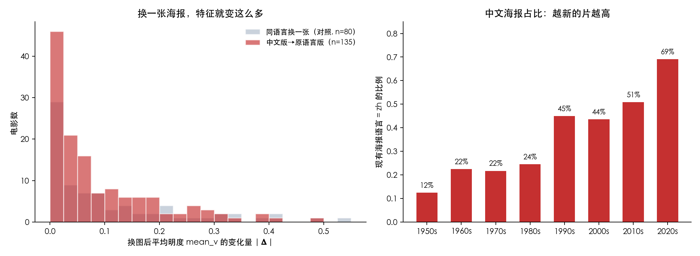

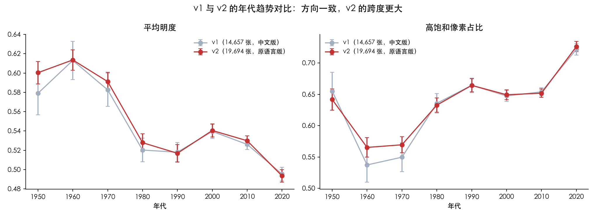

### 2.3 补充详情与制片国家归属规则

通过 `/movie/{id}` 详情接口补充 `movie_details.csv`（19,700 条全覆盖），与匹配特征的 19,694 部影片一对一连接后，19,674 部具有明确制片国家记录（覆盖 130 个国家／地区），仅 20 部缺失。针对多国合拍片，为避免一部电影重复计入多个国家，空间分析结合 `production_countries` 与 `original_language` 建立唯一归属规则：单一制片国直接归组；中国大陆、香港、台湾合并为「华语组（ZH）」；多国合拍片匹配原语言对应候选国（唯一命中归该国，多候选命中主要母国如英语归 US、法语归 FR），无法唯一判定的标为 `AMBIG`（2001—2025 年仅占 2.99%）不纳入组间比较。

---

## 3. 特征工程与统计方法

### 3.1 图像预处理与近灰像素掩膜

所有 19,694 张海报（原始尺寸约 $342 \times 512$）按统一流水线提取 24 维色彩特征：

1. **底部演职员表裁剪**：切除图像底部 12% 区域，消除密集白／黑演职员小字、发行方标志与分级角标对底色统计的系统性干扰，随后等比缩放至 $120 \times 160$。
2. **全图连续指标计算**：转换至 RGB 与 HSV 空间（$H \in [0, 360)$，$S, V \in [0, 1]$），在全幅画面上计算**平均明度 `mean_v`**、**平均饱和度 `mean_s`**、**明暗对比度 `v_std`**（$V$ 的标准差），以及 Hasler–Süsstrunk **色彩丰富度 `colorful`**：
   $$\text{colorful} = \sqrt{\sigma_{rg}^2 + \sigma_{yb}^2} + 0.3\sqrt{\mu_{rg}^2 + \mu_{yb}^2}, \quad rg = R - G,\; yb = \frac{R + G}{2} - B$$
3. **近灰像素掩膜与色相质量闸门**：在 HSV 空间中，黑底、白字与银幕灰影等低饱和像素（$S \to 0$）的色相角 $H$ 受压缩量化噪声支配而随机跳变，若直接纳入会把聚类质心全部拉向近黑并污染色相直方图。因此定义**近灰像素掩膜 $\text{mask} = (S \ge 0.20)$**，记录有色像素占全图比例 `sat_frac`。仅在掩膜像素数不少于 200 的海报上计算饱和度加权圆均值色相 `hue`、归一化的 **12 个 $30^\circ$ 扇区色相占比 `h0`–`h11`**（`h0` 为 $0^\circ\text{–}30^\circ$ 红，`h4` 为 $120^\circ\text{–}150^\circ$ 绿，`h7` 为 $210^\circ\text{–}240^\circ$ 蓝）及掩膜像素 K-Means（$k=3$）提取的前三大主色 `dom1`–`dom3` 与面积权重 `ds1`–`ds3`。
4. **分指标筛选原则**：明度、饱和度与丰富度在黑白或近灰海报上具有明确的物理意义，故保留全部 19,694 部有效记录；凡涉及色相构成与色型聚类的分析，统一施加质量闸门 **`sat_frac ≥ 0.10`**（排除 622 张近纯灰海报，保留 **19,072 部**有效样本），色相占比先在单张海报内校验归一（$\sum_{i=0}^{11} h_i = 1$），再对组内电影等权平均。

### 3.2 统计推断与无监督建模设计

1. **多标签联合重采样 Bootstrap**：一部电影通常具有 1—3 个类型标签（如「科幻」与「恐怖」共享 588 部影片）。若将重叠组直接拼入列联表做常规 Pearson 卡方检验，会导致同一部电影被重复计数并破坏观测独立性。因此，跨类型差值统一采用**整库电影级联合 Bootstrap（1,000 次）**：每次对 19,694 部独立电影有放回抽取等规模样本，在同一次重抽样本上同步计算两组均值差，取 2.5% 与 97.5% 分位数作为逐项 95% 置信区间（精确保留重叠影片协方差）；同时补充严格剔除重叠片后的互斥子集 Kruskal–Wallis 检验及效应量 $\eta^2_H = (H - k + 1)/(N - k)$。年代与互斥国家组对比同样采用 1,000 次电影级 Bootstrap 估计逐项 95% CI。
2. **HSV 圆锥色度无监督聚类**：色相角具有 $0^\circ \equiv 360^\circ$ 周期拓扑；若仅将 $\cos H$ 与 $\sin H$ 单独标准化，低饱和近灰海报与高纯度海报在色相方向上会获得相同欧氏权重。为此构造五维**圆锥色度特征 `Conic_5D`**：
   $$\mathbf{x} = \bigl[\text{mean\_v},\; \text{mean\_s},\; \text{colorful},\; \text{mean\_s}\cdot\cos(\text{hue}),\; \text{mean\_s}\cdot\sin(\text{hue})\bigr]$$
   经 Z-score 标准化后，在 3 种特征空间（`Conic_5D`、单位圆 `Base_5D`、全扇区 `Spectral_15D`）$\times$ 3 种聚类模型（K-Means、Bisecting K-Means、GMM）$\times$ $k \in \{2,3,4,5,6\}$ 共 45 组配置上评估轮廓系数、Calinski–Harabasz（CH）、Davies–Bouldin（DB）及 80% 随机无放回子样本重训一致性（Adjusted Rand Index, ARI）。

---

## 4. 结构维度（图 1）：电影类型的配色分化与客观色型聚类

### 4.1 预设类型对比：明度主导梯度与冷暖光谱分野

我们对样本量均超过 1,600 部的九类主流电影（喜剧、动画、爱情、剧情、动作、犯罪、科幻、惊悚、恐怖）及全库基线进行对比，并重点检验科幻、爱情、恐怖三类典型题材（图 1a，表 2）。

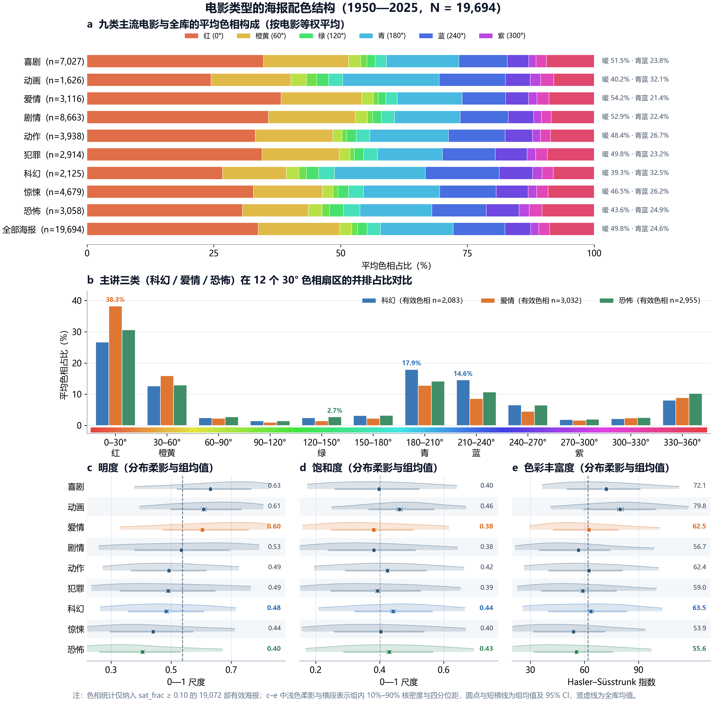

| 电影类型 | 总片数 $n$ | 色相有效 $n_{\text{hue}}$ | 明度均值 [95% CI] | 饱和度均值 [95% CI] | 丰富度均值 [95% CI] | $0^\circ\text{–}60^\circ$ 暖色占比 | $180^\circ\text{–}240^\circ$ 青蓝占比 |
| --- | ---: | ---: | --- | --- | --- | ---: | ---: |
| 喜剧 | 7,027 | 6,906 | 0.6305 [0.6264, 0.6343] | 0.3980 [0.3939, 0.4021] | 72.09 [71.40, 72.77] | 51.55% | 23.84% |
| 动画 | 1,626 | 1,598 | 0.6082 [0.6012, 0.6162] | 0.4616 [0.4538, 0.4700] | 79.80 [78.34, 81.40] | 40.21% | 32.14% |
| 爱情 | 3,116 | 3,032 | 0.6034 [0.5970, 0.6096] | 0.3813 [0.3753, 0.3879] | 62.48 [61.45, 63.49] | 54.18% | 21.38% |
| 剧情 | 8,663 | 8,286 | 0.5341 [0.5297, 0.5383] | 0.3820 [0.3781, 0.3860] | 56.69 [56.08, 57.33] | 52.92% | 22.43% |
| 动作 | 3,938 | 3,883 | 0.4926 [0.4873, 0.4981] | 0.4243 [0.4188, 0.4298] | 62.43 [61.51, 63.34] | 48.44% | 26.68% |
| 犯罪 | 2,914 | 2,818 | 0.4898 [0.4825, 0.4974] | 0.3934 [0.3866, 0.4002] | 59.04 [57.92, 60.17] | 49.76% | 23.24% |
| 科幻 | 2,125 | 2,083 | 0.4835 [0.4764, 0.4912] | 0.4421 [0.4345, 0.4494] | 63.53 [62.32, 64.82] | 39.35% | 32.48% |
| 惊悚 | 4,679 | 4,511 | 0.4401 [0.4345, 0.4453] | 0.4035 [0.3981, 0.4087] | 53.92 [53.10, 54.71] | 46.45% | 26.18% |
| 恐怖 | 3,058 | 2,955 | 0.4044 [0.3973, 0.4113] | 0.4296 [0.4224, 0.4365] | 55.58 [54.49, 56.68] | 43.61% | 24.91% |
| **全库基线** | **19,694** | **19,072** | **0.5376 [0.5350, 0.5404]** | **0.4008 [0.3981, 0.4032]** | **61.96 [61.53, 62.37]** | **49.83%** | **24.56%** |

数据分析揭示出三项核心结构特征：

1. **明度形成跨度近 0.23 的清晰类型阶梯**：从喜剧（0.6305）、动画（0.6082）、爱情（0.6034）的高调明亮，经由贴近全库均值的剧情片（0.5341），一路下探至动作（0.4926）、犯罪（0.4898）、科幻（0.4835），并在惊悚（0.4401）与恐怖（0.4044）达到最低谷。在主讲三类联合 Bootstrap 对比中，爱情片平均明度比恐怖片高 **+0.1990**（95% CI $[+0.1902, +0.2078]$），比科幻片高 **+0.1200**（$[+0.1102, +0.1295]$）；在剔除重叠影片后的 6,840 部严格互斥三类子集上，明度 Kruskal–Wallis 检验 $H = 1501.1$（$p < 10^{-300}$），效应量高达 $\eta^2_H = 0.2193$，远大于饱和度（$\eta^2_H = 0.0233$）与丰富度（$\eta^2_H = 0.0238$）。
2. **色相呈现「爱情暖红、科幻青蓝、恐怖偏绿」的波段分野**：在 12 扇区分布中（图 1a 面板 b），爱情片在 $0^\circ\text{–}30^\circ$ 红橙扇区高达 38.27%（$0^\circ\text{–}60^\circ$ 合计 54.18%，较科幻片高 **+14.83 个百分点**，$[+13.23, +16.39]$）；科幻片与动画片在 $180^\circ\text{–}240^\circ$ 青蓝波段分别占 32.48% 与 32.14%（科幻较爱情高 **+11.09 个百分点**，$[+9.55, +12.60]$）；恐怖片在 $90^\circ\text{–}150^\circ$ 黄绿／冷绿波段占比（4.22%）显著高于爱情片（2.48%，差值 $+1.73$ 个百分点，$[+1.26, +2.19]$）。
3. **柔和浅亮与高彩浓烈的区分**：动画片的平均饱和度（0.4616）与色彩丰富度（79.80，较全库高 $+17.84$）高居榜首；相比之下，爱情片虽然高明度、高暖色，但其平均饱和度（0.3813）反而低于科幻片（0.4421）与恐怖片（0.4296），说明大量爱情片采用的是柔和浅底暖调而非浓烈高纯度涂抹。

### 4.2 不预设类型的无监督聚类：四类客观色型与共享模板机制

在遮蔽所有类型标签的 45 组聚类基准测试中，圆锥色度特征 `Conic_5D + K-Means (k=4)` 取得全场最低的 Davies–Bouldin 指数（**1.1803**，优于单位圆 `Base_5D` 的 1.2060 与 12 扇区 `Spectral_15D` 的 1.8594）、最高的 Calinski–Harabasz 指数（**7,213.5**）以及高达 **0.9913** 的子样本重训一致性 ARI（图 1b 面板 a；GMM 因高斯椭球假设与有界环形色度空间冲突，轮廓系数跌至 0.0216）。PCA 前两主成分累计解释 **64.30%** 的特征方差，四类客观色型在二维色度流形上自然分布于上、右、下、左四个方位（图 1b 面板 b，图 1c 上排）：

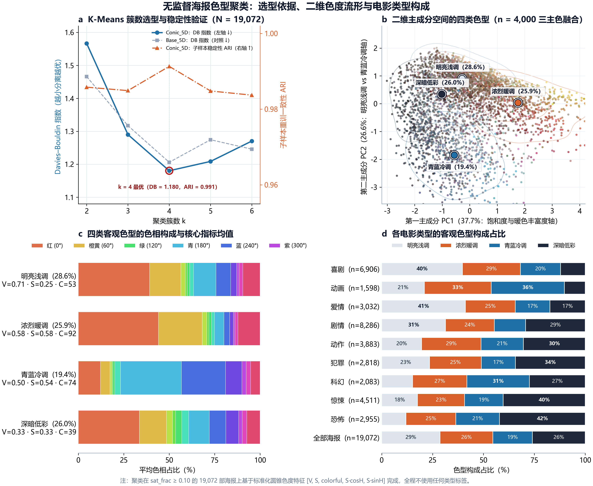

- **明亮浅调（5,464 部，占 28.65%）**：平均明度最高（0.7125）、平均饱和度最低（0.2526）、丰富度适中（53.24），对应大面积浅白／米色背景海报。**爱情片（41.1%，较全库高 +12.4 个百分点）**与**喜剧片（39.6%，+11.0 个百分点）**高度集中于此，而恐怖片仅占 11.9%（−16.7 个百分点）。
- **浓烈暖调（4,946 部，占 25.93%）**：高饱和度（0.5758）、全库最高色彩丰富度（92.07），$0^\circ\text{–}60^\circ$ 红橙黄占比高达 **68.14%**（圆均值色相 $19.9^\circ$，集中度 $R = 0.90$）。动画（32.9%，+6.9 个百分点）、动作（29.2%）与喜剧（28.5%）在此类占比突出。
- **青蓝冷调（3,704 部，占 19.42%）**：高饱和度（0.5367）、高丰富度（74.06），$180^\circ\text{–}240^\circ$ 青蓝占比高达 **57.81%**（圆均值色相 $224.4^\circ$，$R = 0.83$）。**动画片（35.9%，+16.5 个百分点）**与**科幻片（30.8%，+11.4 个百分点）**在此类显著富集——其中动画片在「青蓝冷调 + 浓烈暖调」两大高饱和色型合计占比达 **68.8%**。
- **深暗低彩（4,958 部，占 25.99%）**：平均明度最低（0.3296）、色彩丰富度最低（38.65）。**恐怖片（42.1%，+16.1 个百分点）**、**惊悚片（40.3%，+14.3 个百分点）**与**犯罪片（34.3%，+8.3 个百分点）**以此为主导模板，而动画（10.3%）与喜剧（12.1%）明显规避。

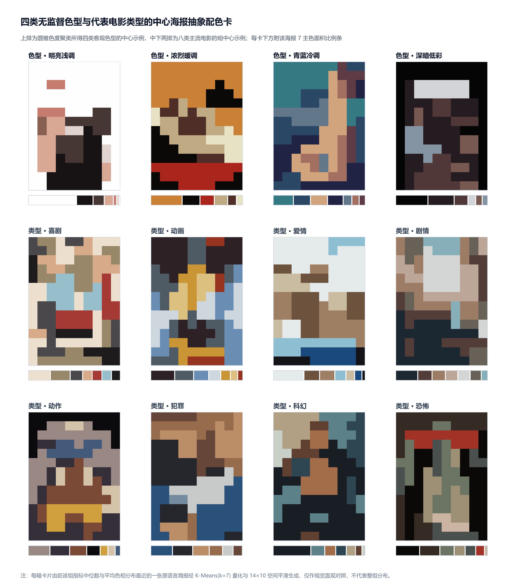

无监督聚类的关键启示在于：数据自动聚出的色型数（$k=4$）既不等于预设的 3 类，也不等于 TMDB 的 19 个类型；由于连续色彩空间的轮廓系数为 0.2675，**电影工业并非「一个类型绑定一种排他色彩」，而是全行业共享上述四类基础色型模板，通过改变模板配比来传递类型预期**。

---

## 5. 时间维度（图 2）：1950—2025 年全球海报配色的长期演变

在全部 19,694 部匹配影片上按上映年份考察七十六年间的全球配色轨迹（图 2a、图 2b，表 3）。为兼顾去噪平滑与局部拐点保留，年度趋势采用完整五年居中移动窗口（1952—2023 年）计算片间中位数与四分位距（IQR），并对预定完整年代组合执行 1,000 次重采样均值差估计。

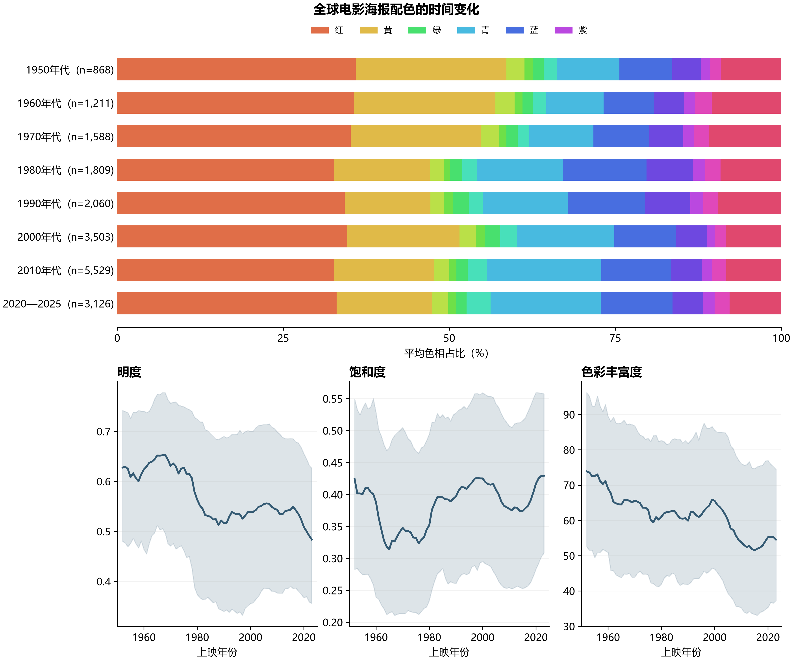

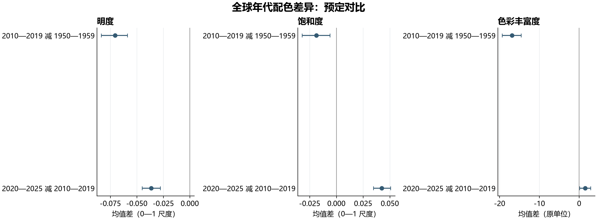

| 对比组 | 指标 | 前组均值 | 后组均值 | 均值差（前 − 后） | 逐项 95% CI | 样本量（前／后） |
| --- | --- | ---: | ---: | ---: | --- | ---: |
| 2010s − 1950s | 明度 (`mean_v`) | 0.5299 | 0.6004 | **−0.0705** | [−0.0835, −0.0588] | 5,529 / 868 |
| 2010s − 1950s | 饱和度 (`mean_s`) | 0.3937 | 0.4124 | **−0.0187** | [−0.0320, −0.0060] | 5,529 / 868 |
| 2010s − 1950s | 丰富度 (`colorful`) | 57.00 | 73.89 | **−16.88** | [−19.33, −14.57] | 5,529 / 868 |
| 2020–2025 − 2010s | 明度 (`mean_v`) | 0.4935 | 0.5299 | **−0.0364** | [−0.0450, −0.0277] | 3,126 / 5,529 |
| 2020–2025 − 2010s | 饱和度 (`mean_s`) | 0.4361 | 0.3937 | **+0.0424** | [+0.0347, +0.0507] | 3,126 / 5,529 |
| 2020–2025 − 2010s | 丰富度 (`colorful`) | 58.52 | 57.00 | **+1.52** | [+0.13, +2.89] | 3,126 / 5,529 |

时间维度呈现两项核心事实：

1. **长期变暗、丰富度收束与青蓝占比扩张**：从完整十年对比看，2010 年代相对 1950 年代的平均明度降低 0.0705（全期 76 年年度中位数 Spearman $\rho = -0.7524$，Theil–Sen 斜率每十年 $-0.0189$），色彩丰富度大幅降低 16.88（$\rho = -0.8042$，每十年 $-2.48$）。在色相构成上，1950 年代手绘插画海报以红橙与明黄为主（$0^\circ\text{–}60^\circ$ 合计 **58.6%**，$180^\circ\text{–}240^\circ$ 青蓝仅 **17.4%**）；自 1980 年代起青蓝波段明显扩张，至 2010 年代 $0^\circ\text{–}60^\circ$ 降至 **47.8%**，而 $180^\circ\text{–}240^\circ$ 升至 **27.7%**（结合第 4 节色型演化表 `cluster_by_decade.csv`，深暗低彩占比由 1950s 的 16.8% 升至 2020s 的 31.1%，明亮浅调由 35.1% 降至 18.8%）。
2. **饱和度轨迹显著非单调，否定「一路变灰」假说**：平均饱和度在 1950 年代较高（0.4124），1960—1970 年代回落至低谷（约 0.358），1980—1990 年代回升至 0.4167，2010 年代小幅回调（0.3937），而在 2020—2025 年再度显著攀升至 **0.4361**（较 2010 年代高 $+0.0424$）。这一全量观测纠正了早期 300 张小样本试跑时「海报持续去饱和」的误判——数字时代的流媒体缩略图竞争在压低背景明度的同时，反而强化了局部高饱和色彩对比（各年代中心单张海报的抽象色块直观示意参见图 2c，统计推断仍以图 2a、图 2b 全组均值为准）。

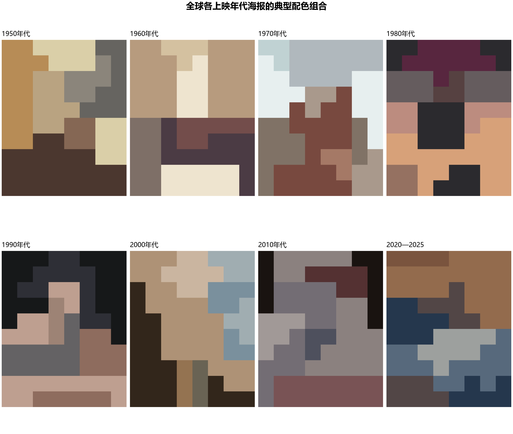

---

## 6. 效用维度（图 3）：海报配色能否预测影片口碑？

既然海报配色在不同类型与年代间分化显著，某种配色（例如更深沉的低明度或更克制的色彩丰富度）是否对应更高的观众口碑？我们在全部有评分且非纯黑（`vote_average > 0` 且 `sat_frac > 0`）的 **19,592 部**电影上检验配色指标与 TMDB 均分的线性及分类型关联（图 3，表 4）。

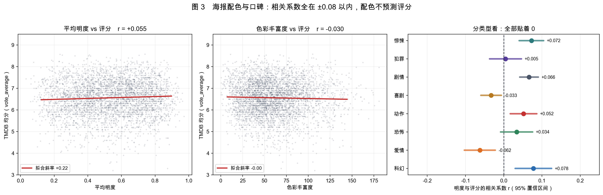

| 统计范围 | 样本量 $n$ | 明度与均分 $r$ [95% CI] | 饱和度与均分 $r$ | 丰富度与均分 $r$ | 明度相关 $p$ 值 |
| --- | ---: | --- | ---: | ---: | ---: |
| **全库总计** | **19,592** | **+0.047** [+0.033, +0.061] | **−0.052** | **−0.045** | $< 10^{-10}$ |
| 科幻 | 2,117 | +0.039 [−0.004, +0.081] | +0.007 | +0.003 | 0.075 |
| 爱情 | 3,100 | −0.079 [−0.114, −0.044] | +0.003 | −0.067 | $9.7 \times 10^{-6}$ |
| 恐怖 | 3,046 | −0.020 [−0.055, +0.016] | −0.050 | −0.064 | 0.280 |
| 动作 | 3,933 | +0.029 [−0.002, +0.061] | −0.024 | −0.017 | 0.065 |
| 喜剧 | 7,007 | −0.042 [−0.066, −0.019] | +0.022 | −0.028 | $3.9 \times 10^{-4}$ |
| 剧情 | 8,603 | +0.048 [+0.027, +0.069] | −0.057 | −0.030 | $7.0 \times 10^{-6}$ |
| 犯罪 | 2,907 | −0.006 [−0.042, +0.031] | −0.052 | −0.035 | 0.765 |
| 惊悚 | 4,659 | +0.055 [+0.026, +0.083] | −0.064 | −0.004 | $1.8 \times 10^{-4}$ |

实证结果十分明确：**所有整体与分类型相关系数 $|r|$ 全部落在 $0.08$ 以内，决定系数 $R^2 < 0.0064$，配色对评分几乎没有任何解释或预测能力**。

这一结果为大样本数据分析提供了典型范例：当 $N = 19,592$ 时，即便相关系数仅为 $r = +0.047$，零假设检验也会给出 $p < 10^{-10}$ 的「极显著」结果；分类型看，剧情片（$n = 8,603, r = +0.048$）与爱情片（$n = 3,100, r = -0.079$）同样 $p < 10^{-5}$。但从效应量与回归斜率看（明度从 0 到 1 全程跨度仅对应均分变化 0.19 分），这种关联在业务与视觉感知上近似为零。结合第 4 节结论可知：**海报配色的功能是降低观众的信息搜寻成本、准确传达「这是一部什么类型的电影」，而不是区分烂片与佳作。**

---

## 7. 空间维度（图 4）：2001—2025 年主要国家／地区组的配色差异

为避免早期胶片年代各国收录率极度悬殊造成的时代混杂，空间比较聚焦于 **2001—2025 年**。该时段共有 11,918 部匹配电影，按第 2.3 节唯一归属规则纳入美国（US）、法国（FR）、英国（GB）、意大利（IT）、日本（JP）、韩国（KR）与华语组（ZH）七组共 **10,115 部**电影（图 4a、图 4b，表 5）。分析保留各组真实的影片类型结构，并以样本量最大的美国组作为共同参照系计算均值差。

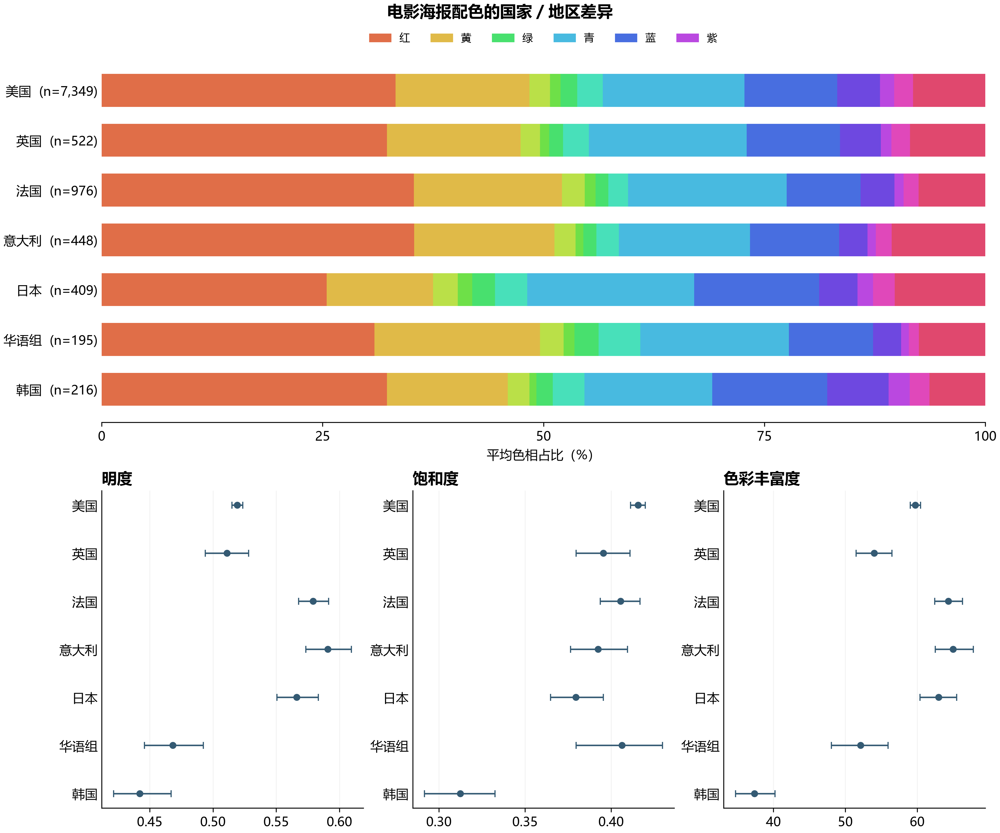

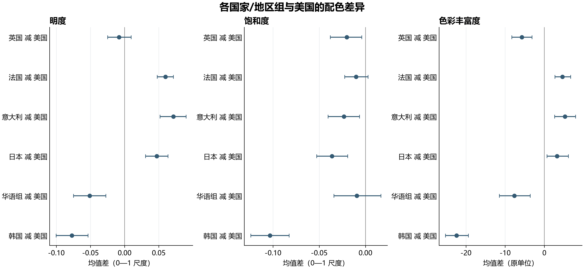

| 国家／地区组 | 电影数 $n$ | 色相有效 $n_{\text{hue}}$ | 明度均值 | 相对美国明度差 [95% CI] | 饱和度均值 | 相对美国饱和度差 [95% CI] | 丰富度均值 | $0^\circ\text{–}60^\circ$ 暖色占比 |
| --- | ---: | ---: | ---: | --- | ---: | --- | ---: | ---: |
| 美国 (US) | 7,349 | 7,157 | 0.5193 | 参照组 (0) | 0.4156 | 参照组 (0) | 59.75 | 48.41% |
| 英国 (GB) | 522 | 505 | 0.5112 | −0.0081 [−0.0249, +0.0096] | 0.3954 | −0.0202 [−0.0380, −0.0040] | 54.02 | 47.40% |
| 法国 (FR) | 976 | 954 | 0.5791 | **+0.0598** [+0.0477, +0.0715] | 0.4054 | −0.0102 [−0.0225, +0.0028] | 64.35 | 52.07% |
| 意大利 (IT) | 448 | 440 | 0.5908 | **+0.0715** [+0.0519, +0.0901] | 0.3924 | −0.0232 [−0.0404, −0.0064] | 65.02 | 51.23% |
| 日本 (JP) | 409 | 401 | 0.5663 | **+0.0470** [+0.0306, +0.0636] | 0.3795 | −0.0361 [−0.0528, −0.0191] | 63.00 | **37.50%** |
| 华语组 (ZH) | 195 | 189 | 0.4682 | **−0.0511** [−0.0748, −0.0275] | 0.4063 | −0.0093 [−0.0341, +0.0167] | 52.11 | 49.62% |
| 韩国 (KR) | 216 | 207 | 0.4420 | **−0.0772** [−0.1003, −0.0535] | 0.3124 | **−0.1032** [−0.1240, −0.0825] | 37.34 | 45.95% |

空间对比呈现出清晰的区域梯度：

1. **欧洲大陆（法、意）与日本组整体偏亮，英美居中，华语组与韩国组显著偏暗**：法国组与意大利组平均明度分别比美国组高出 0.0598 与 0.0715，色彩丰富度亦高出约 4.6—5.3 个单位（与法意院线片中喜剧、剧情及浅底海报占比更高相呼应）；英国组在明度上与美国组无显著差异（$-0.0081$，95% CI 跨 0）。相反，华语组与韩国组平均明度分别低于美国组 0.0511 与 0.0772，其中韩国组的平均饱和度（0.3124，较美国低 **0.1032**）与色彩丰富度（37.34，较美国低 **22.41**）均为七组最低，与 21 世纪韩国热门外输影片中犯罪、惊悚及低饱和冷暗基调商业片占比较高直接相关。
2. **日本组的色相构成独树一帜**：日本组在 $0^\circ\text{–}60^\circ$ 红橙黄波段仅占 **37.50%**（较美国组 48.41% 低近 11 个百分点），而在 $180^\circ\text{–}240^\circ$ 青蓝波段高达 **33.02%**（美国组为 26.54%），体现出日本动画及青春／奇幻影片对天空蓝与青冷色调的高频使用（七组中心单张海报抽象色块直观示意参见图 4c）。

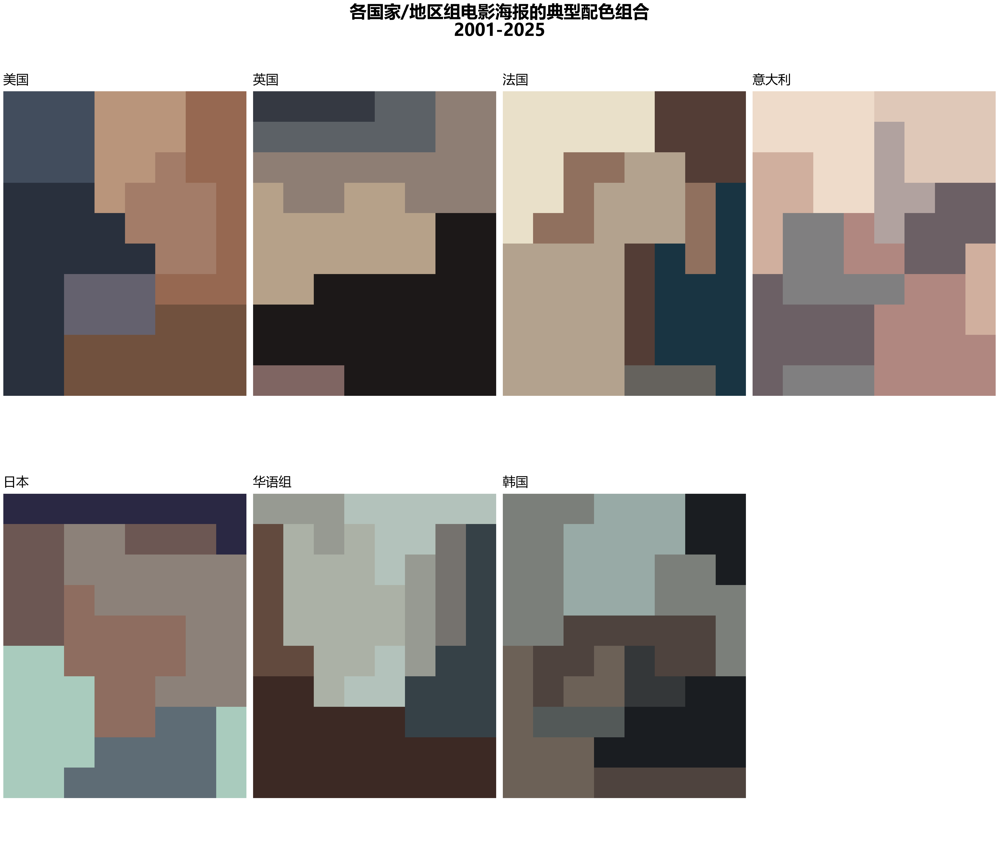

---

## 8. 讨论与局限性分析（Threats to Validity）

### 8.1 综合讨论：什么是「套路」，什么是「趋势」？

将四个维度的实证证据串联起来，可以得到一幅完整的行业图景：
- **横向看（结构与空间）**，海报配色存在高度稳定的视觉编码惯例——全行业共享「明亮浅调、浓烈暖调、青蓝冷调、深暗低彩」四类基础色型，喜剧／爱情偏向浅亮暖调，科幻／动画富集青蓝与高彩，恐怖／惊悚／犯罪重度依赖深暗低彩；不同国家／地区因主流优势片种与宣发传统差异，进一步叠加了欧洲偏亮、韩华偏暗冷、日本高青蓝的区域面貌。
- **纵向与效用看（时间与评分）**，七十六年间海报背景整体向低明度与青蓝波段偏移，但近期流媒体环境又推高了饱和度；而无论配色如何变化，它与观众口碑均分的相关系数始终贴近 0。换言之，**配色解决的是「分类定位问题」，而非「质量高低问题」**。

### 8.2 有效性威胁与研究边界

为防止过度推断，本文从内部有效性、外部有效性与结构有效性三个层面明确以下五项局限：

1. **电影上映年份不等于海报设计年份（内部有效性）**：TMDB 图片接口不提供海报发行日期字段。尽管 v2 已剔除中文化海报并锁定原语言版，但高票老片在原语言池中仍可能选中近年蓝光修复版或周年重映版海报（如 1950 年《仙履奇缘》最高票英文图实为 2012 年钻石版），这会部分稀释早年与现代之间的真实历史差幅。
2. **印制媒介演进与审美变化混杂（内部有效性）**：1950—1970 年代海报以石版印刷手绘插画为主（纸面留白多、颜料明度高），而 2000 年后全面转向数字摄影暗房合成与流媒体小图展示。观测到的明度下降（$-0.0705$）同时包含媒介制作工艺迭代与视觉风格迁移，不能单一归因为「审美变暗」。
3. **推定国家组不等于设计地或民族文化因果（结构有效性）**：合拍片归属依赖制片国与原语言规则，且未控制各组内部的影片类型结构差异（如韩国组犯罪／惊悚片占比远高于法国组）。组间均值差是对当前入库影片构成的客观描述，不能直接作「国家文化审美心理」的因果推断。
4. **整幅统计未分离前景主体与背景（结构有效性）**：现有特征对裁去底部 12% 后的整幅图像聚合，尚无法区分「大面积纯黑背景 + 小面积高亮霓虹主体」与「整幅均匀灰暗画面」的空间构图差异。
5. **平台覆盖偏倚与近期右删失（外部有效性）**：动态「每年前 2.6%」门槛虽拉平了年代通过率，但 TMDB 投票群体仍以欧美及英语院线观众为主，非英语冷门地区早期影片代表性有限；同时 2020—2025 年并非完整十年，新片投票尚在累积中（右删失）。

---

## 9. 附录：稳健性核验与可复现工程清单

### 附录 A. 肤色扇区屏蔽与近灰过滤阈值敏感性核验

由于所有类型海报在 $0^\circ\text{–}60^\circ$ 红橙黄波段占比均较高（混有人物面部特写肤色与暖光），为检验类型冷暖差异是否仅由「爱情片人脸更大、科幻片无人脸」造成，我们在每张海报内部屏蔽 `h0`、`h1`（$0^\circ\text{–}60^\circ$）并对剩余 $60^\circ\text{–}360^\circ$ 非肤色扇区重新归一化（图 A1 面板 e）：科幻片在 $180^\circ\text{–}240^\circ$ 青蓝占比（**46.82%**）依然显著高于爱情片（**39.89%**，差值 $+6.93$ 个百分点，95% CI $[+5.06, +8.82]$）与恐怖片（**35.19%**，差值 $+11.63$ 个百分点）；恐怖片在 $90^\circ\text{–}150^\circ$ 黄绿／绿占比（**7.72%**）依然显著高于爱情片（**6.08%**，差值 $+1.64$ 个百分点）。同时，将近灰过滤门槛在 $\text{sat\_frac} \in [0.05, 0.20]$ 间连续扫描，三项核心波段差值波动不足 0.3 个百分点（图 A1 面板 f），四类色型聚类划分与主口径的一致性 ARI 保持在 **0.9152—0.9789** 之间，证实全部核心结论对预处理超参数具备强稳健性。

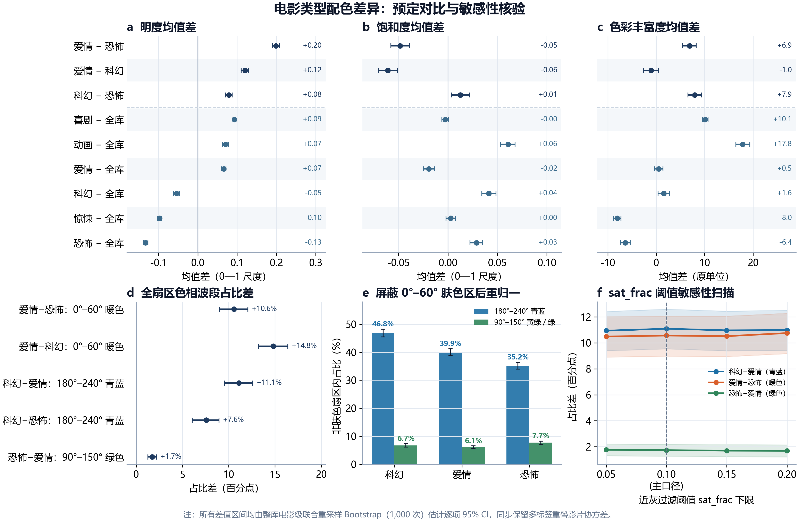

### 附录 B. 仓库模块分工与自动化核验清单

本项目全部数据、特征、统计表、定稿图与自动核验脚本均按只读数据契约沉淀于仓库中，支持无需联网与 API Key 的一键确定性复现：

| 模块 | 负责角色 | 核心代码路径 | 核心定稿产物与自动核验 |
| --- | --- | --- | --- |
| 数据采集与效用分析 | 成员 A | `scripts/01_fetch.py`–`06_details.py`, `common.py` | `data/*.csv`, `figures/fig_q3_score.png`, `data/quality_report.md` |
| 类型结构与无监督聚类 | 成员 B | `outputs/b/scripts/b01_genre.py`–`b99_validate.py` | `figures/b/fig_q1_*.png`, `outputs/b/ppt/`, `outputs/b/reports/validation_report.md`（36 项全通过） |
| 时间演变与跨国对比 | 成员 C | `outputs/c/scripts/c01_country_group.py`–`c99_validate.py` | `figures/c/fig_q2_*.png`, `figures/c/fig_q4_*.png`, `outputs/c/reports/validation_report.md`（70 项全通过） |
| 报告统稿与演示文稿 | 成员 D | `outputs/d/scripts/d01_build_report_docx.py`–`d99_validate.py` | `docs/报告.md`, `docs/报告.docx`, `docs/汇报.pptx`, `outputs/d/validation_report.md` |
